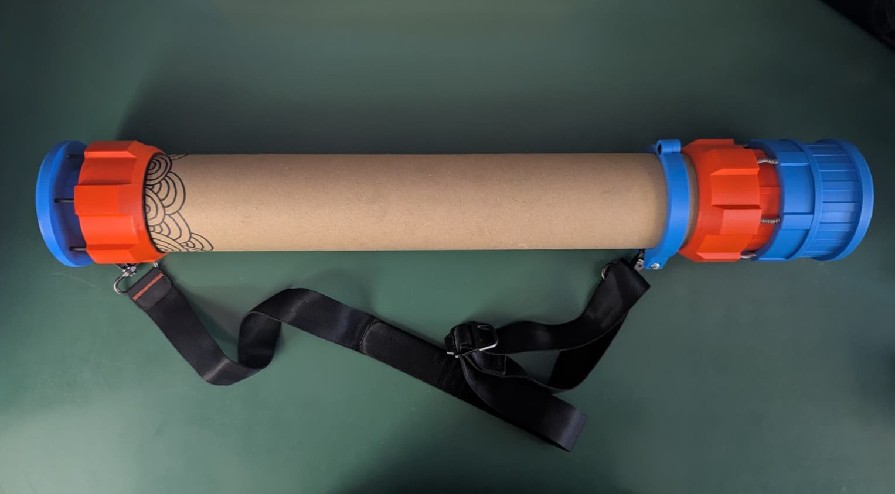
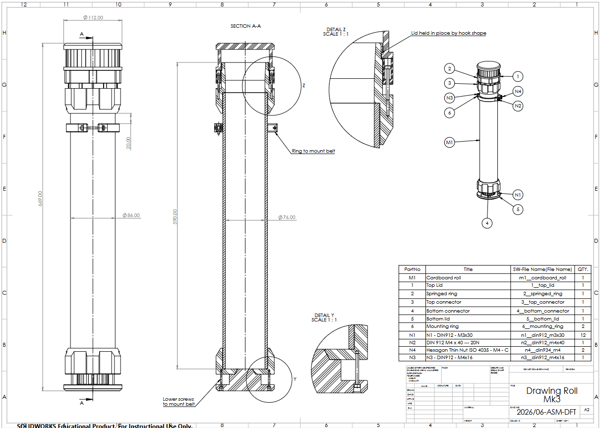

# DrRo - III

    

A rehauled, improved version of ["DrRoll"](https://github.com/SamuelNoesslboeck/DrRoll) that is able to hold A1 paper and features a fancy sealing mechanism.

---

### Construction & Printing

    

For detailed construction information, see the SOLDIWORKS CAD files in the repo. The [main assembly](./a__drro_iii.SLDASM) is located in the root folder. Additionally, a PDF version of the main assembly drawing
with detailed sections and description about the parts can be found [here](./export/a__drro_iii.pdf).

Additionally if you want to build the project yourself, there are STL models of every 3D printed part provided in [this folder](./printing/). Apart from some screws and the base cardboard roll, they make up the whole project. If you also want to use Bambu-Studio, there is even a .3mf-File provided [here](./printing/a__drro_iii.3mf).