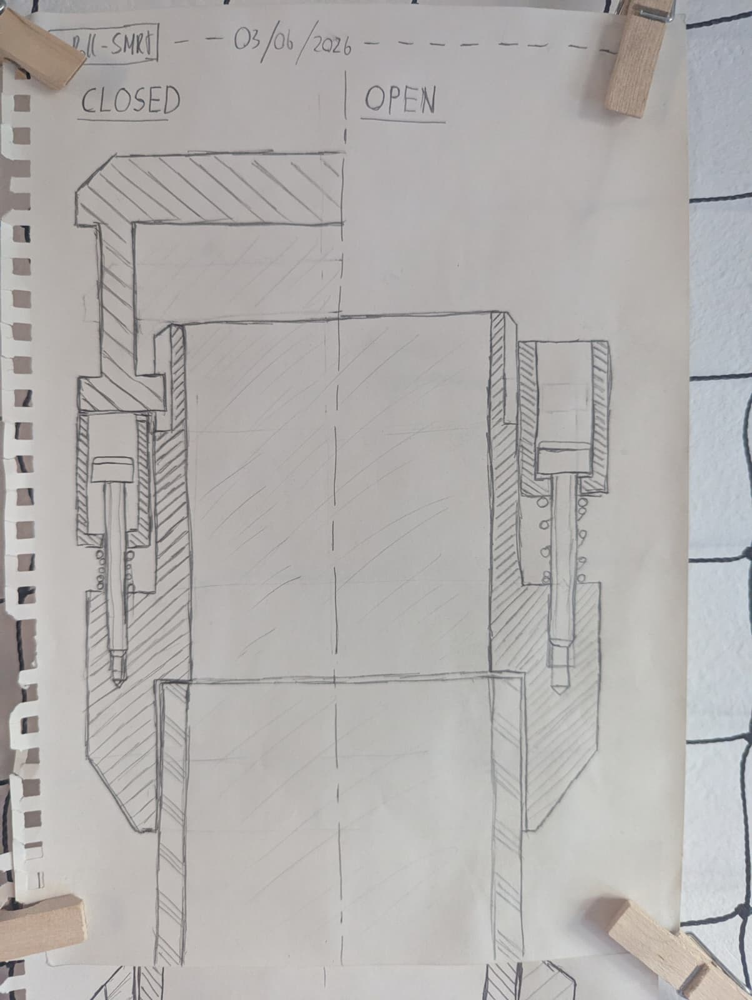
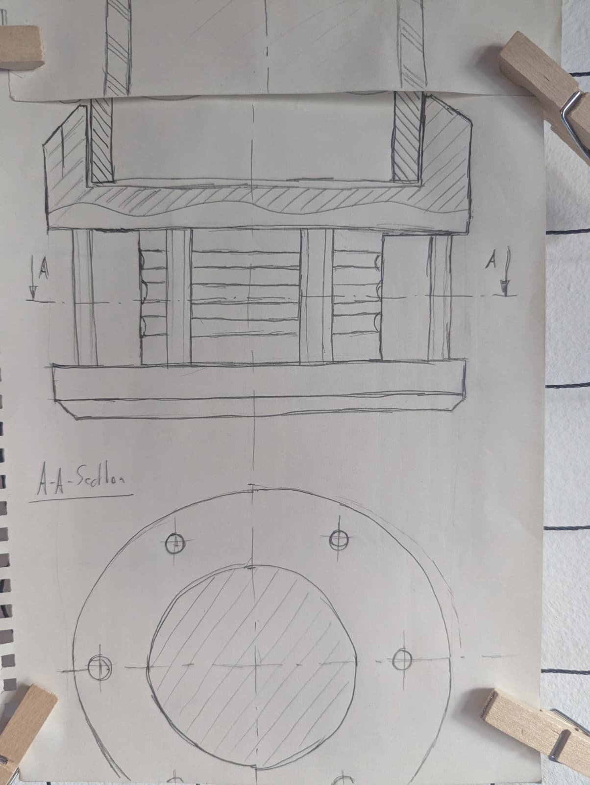
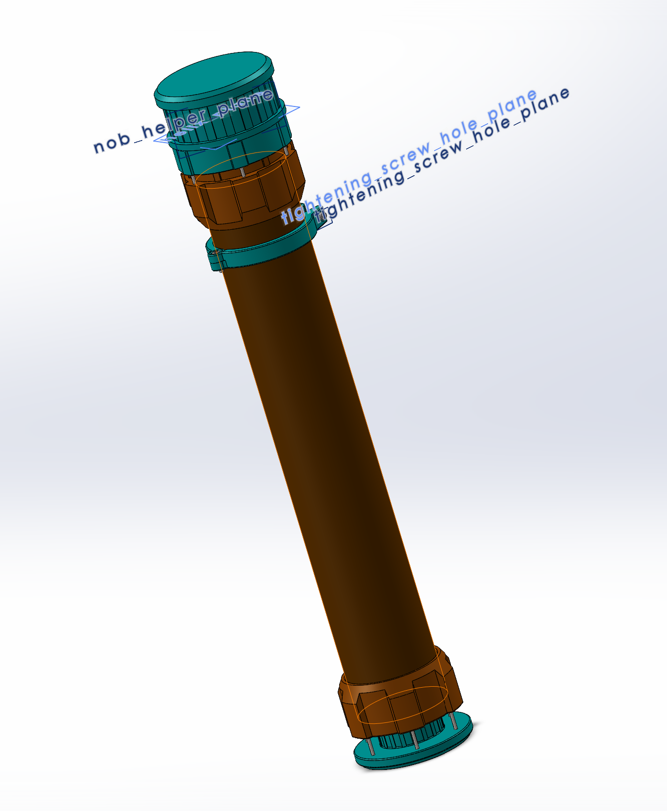
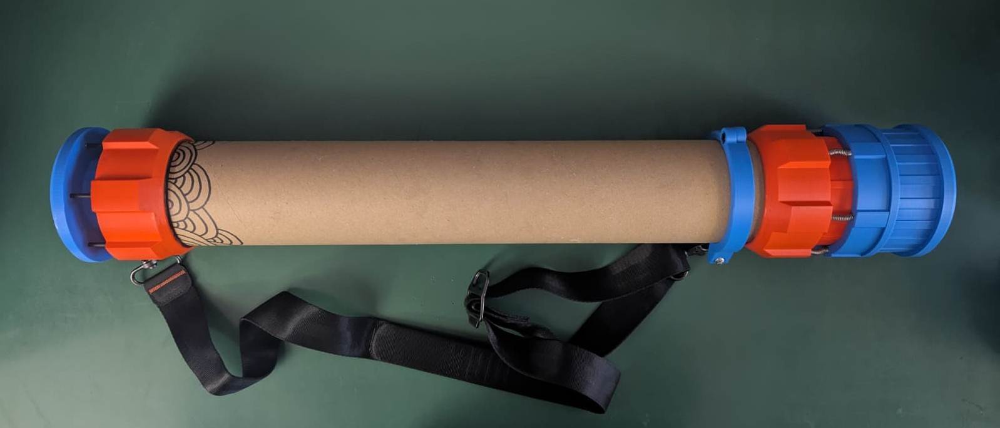
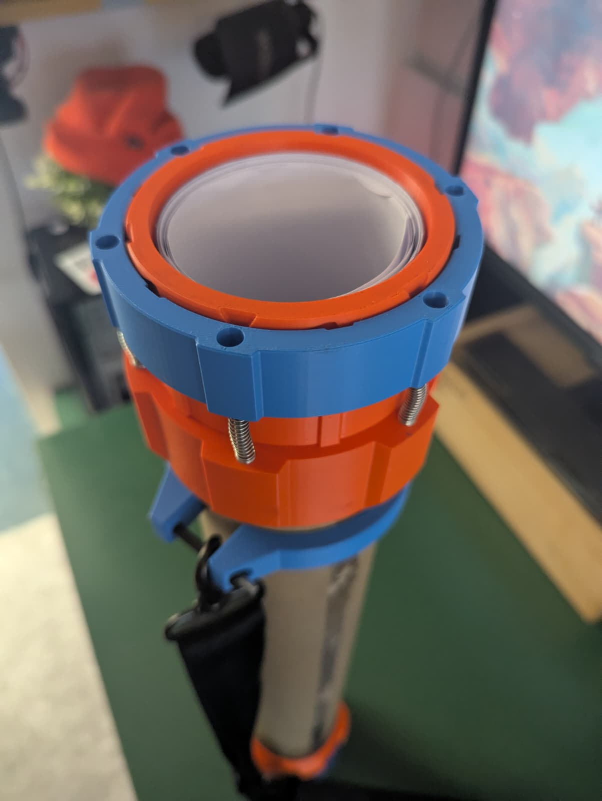
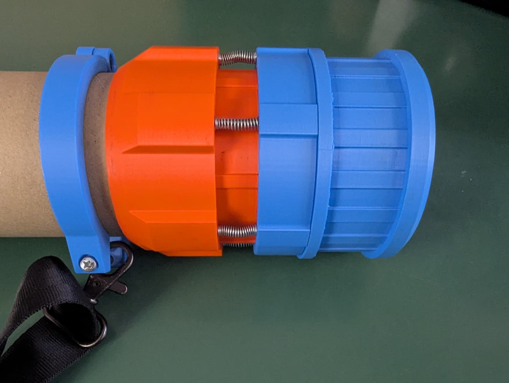

# Project log

## Concept creation (2026/06/03)

The core concept consisted of being an improvement to the [last version](https://github.com/SamuelNoesslboeck/DrRoll) in the following points:

- Better sealing mechanism
- New design with adaptation of core colour scheme
  

    
    

For the new sealing mechanism, I created this concept art using a spring adjusted ring to slide the lid open and to seal it tight. As in previous versions, engravings (this time on the outside) were used to define the lids path.

## CAD Finish & Printing (2026/06/08)

    

For this project SOLIDWORKS was used instead of Solid Edge like the last version. New for this project was the complete parameterization of the CAD, as the dimensions of the inner cardboard roll (which is usually taken from waste) can vary. 

As the project scale is small the printing process already started simultaneously using Bambu Studio as slicer, which also contains a finished configuration of the printing files.

## Finished Assembly (2026/06/12)

    

During the assembly process, no problems arose and the sealing mechanism works smoothly and as intended. In the future there might be issues with the nobs of the upper lid wearing down because of the springs increasing friction, however this wear down seems to be stalling after some point, so there might be no issues at all. 

    
     

